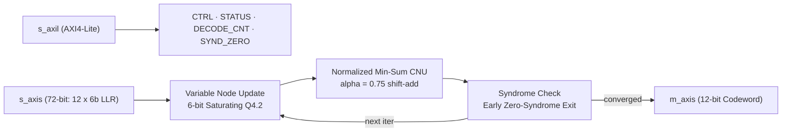

# asap7-6g-ldpc-decoder

[[https://github.com/nk-verif-labs/asap7-6g-ldpc-decoder/actions/workflows/ci.yml/badge.svg]](https://github.com/nk-verif-labs/asap7-6g-ldpc-decoder/actions/workflows/ci.yml)

**1.20 GHz `(12, 6)` QC-LDPC Normalized Min-Sum Decoder** implemented on **ASAP7 (7 nm FinFET predictive PDK)** via **OpenROAD-flow-scripts** and verified with **Cocotb 1.9.2**.

## Architecture Overview



## Physical Design & Signoff Metrics (`asap7`)

| Metric | Value | Status |
| :--- | :--- | :--- |
| **PDK / Track Library** | `asap7` / `asap7sc7p5t_28_R` (7 nm FinFET) | CONFIGURED |
| **Target Clock / Achieved** | `1000 ps` (`1.0 GHz`) / **`831.22 ps` (`1.203 GHz`)** | CLOSED |
| **Setup Slack** | `+125.04 ps` | PASS |
| **Hold Violations** | `0` | PASS |
| **Die / Active Area** | `39.33 × 39.33 µm` (`717 µm²` active, `52%` util) | HARDENED |
| **Routed Instances / Wirelength** | `6,384` cells / `15,874 µm` (`51,002` vias) | ROUTED |
| **Total Power / VDD IR Drop** | `3.11 mW` @ `0.77 V` / `2.41 mV` (`0.31%`) | PASS |
| **Routing DRC / Antenna** | `0` violations | PASS |
| **Logic Equivalence (LEC)** | Post-CTS & Post-Route | PASS |
| **Cocotb 1.9.2 (Icarus & Verilator)** | `16/16` frames (0-bit & 1-bit errors) | PASS |

## Quick Start

### 1. Run Cocotb Verification (Icarus / Verilator)
```bash
source ~/.venvs/cocotb19/bin/activate
make -C tb SIM=icarus && make -C tb SIM=verilator
```

### 2. Run ASAP7 7 nm RTL-to-GDSII (ORFS Docker)
```bash
docker run --rm -v "$PWD":/work -w /OpenROAD-flow-scripts/flow openroad/orfs:latest \
  make DESIGN_CONFIG=/work/orfs/config.mk WORK_HOME=/work/orfs/build
```
